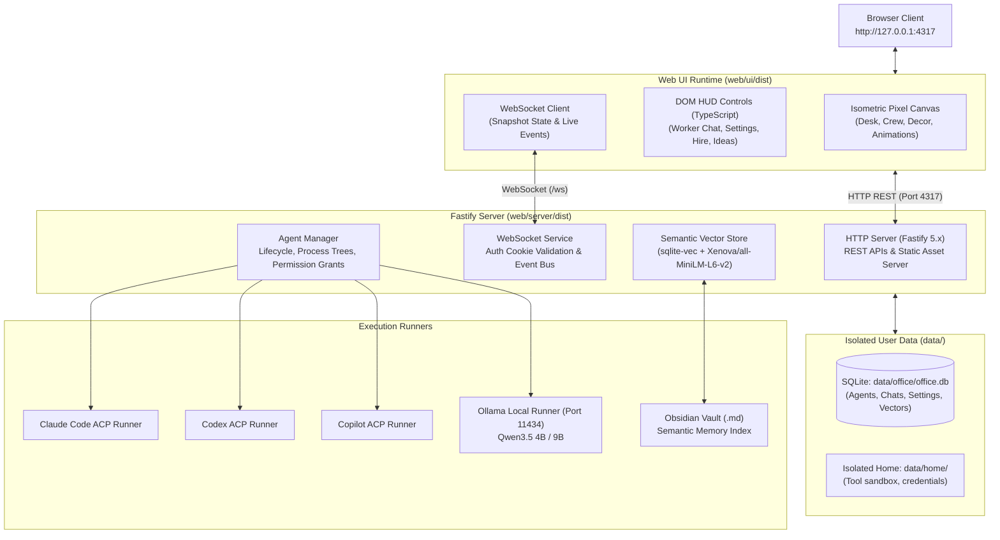

# Onboarding — Start Here

> **Target Audience:** Any third-party engineer or external contributor with **zero prior context** (never worked on this codebase, no historical context required, self-contained).  
> **Design Principles:** **Self-Contained** & **Top-Down**.

---

## 1. Project Introduction (AgentCorp)

**AgentCorp** is a self-hosted personal virtual AI office web application designed and built from scratch for Windows to coordinate autonomous AI coding agents.

- **Frontend (Web UI):** Interactive 2D isometric pixel-art office running in the browser. AI Agents (virtual workers) sit at desks, display real-time animations (typing, thinking, resting), accumulate experience points (XP), levels, outfits, and sound effects.
- **Backend Server:** Node.js powered by **Fastify 5.x** running on local loopback `http://127.0.0.1:4317/`, backed by **SQLite (`better-sqlite3`)** with the **`sqlite-vec`** vector search extension, synchronized via bidirectional **WebSocket** connections.
- **Agent Client Protocol (ACP):** Standardized protocol communicating with AI coding agents over stdio/JSON-RPC:
  - Anthropic Claude Code CLI (`@agentclientprotocol/claude-agent-acp`)
  - OpenAI Codex CLI (`@agentclientprotocol/codex-acp`)
  - GitHub Copilot CLI (`@github/copilot`)
  - Cursor Agent CLI (`agent acp`)
  - **Local AI Engine:** Ollama server (`http://127.0.0.1:11434`) running **Qwen3.5 (4B / 9B)** optimized for local consumer GPUs (e.g. RTX 3050 6GB VRAM).

---

## 2. Five-Minute Quick Start

### Prerequisites
1. **Operating System:** Windows 10 / 11 (64-bit).
2. **Node.js:** Node.js LTS `v20+` or `v24+`.
3. **Web Browser:** Modern Chromium or Firefox.
4. **Local AI (Recommended):** [Ollama](https://ollama.com/) with Qwen3.5:
   ```powershell
   ollama pull qwen3.5:4b
   ```

### Start Steps
Open PowerShell in the workspace root:

```powershell
cd D:\Project\AgentCorp
.\Manage-AgentCorp.ps1 -Action Start    # Starts server in background & opens browser
# Or run foreground: .\Start-Local.ps1
```

To manage the server at any time:
```powershell
.\Manage-AgentCorp.ps1 -Action Status   # View live status of Server, Port, Ollama, and Backups
.\Manage-AgentCorp.ps1 -Action Backup   # Snapshot SQLite database to data/backups/
.\Manage-AgentCorp.ps1 -Action Stop     # Cleanly stop the background process
```

*(Alternatively, run directly with Node)*:
```powershell
node D:\Project\AgentCorp\web\start.mjs
```

### Verification
1. Open your browser and navigate to: **`http://127.0.0.1:4317/`**
2. The pixel-art office UI will render.
3. Review runtime logs at:
   - `evidence/server.stdout.log` (HTTP/WS access and startup logs)
   - `evidence/server.stderr.log` (Runtime warnings and errors)
4. To stop the background server process:
   ```powershell
   Stop-Process -Id (Get-Content D:\Project\AgentCorp\data\server.pid)
   ```

---

## 3. High-Level Architecture



---

## 4. Documentation Map & Reading Order

Follow this reading path to understand the codebase:

| Document / Directory | Purpose |
| :--- | :--- |
| **`docs/Architecture/`** | **Read First:** Comprehensive breakdown of Fastify backend, WebSocket data flow, vector memory, and component map. |
| **`docs/Decisions/`** | **Architecture Decision Records (ADRs):** Explains *why* decisions were made (Web Auth vs API keys, Ollama runner, Obsidian indexing). |
| **`docs/Handoffs/Current-State.md`** | **Operational Reality:** Feature status matrix, test coverage, and known issues. |
| **`docs/TaskLog/`** | **Chronological History:** Step-by-step logs of every modification, touched files, and verification proof. |
| **`docs/Plans/Roadmap.md`** | **Future Direction:** Next phases and upcoming enhancements. |
