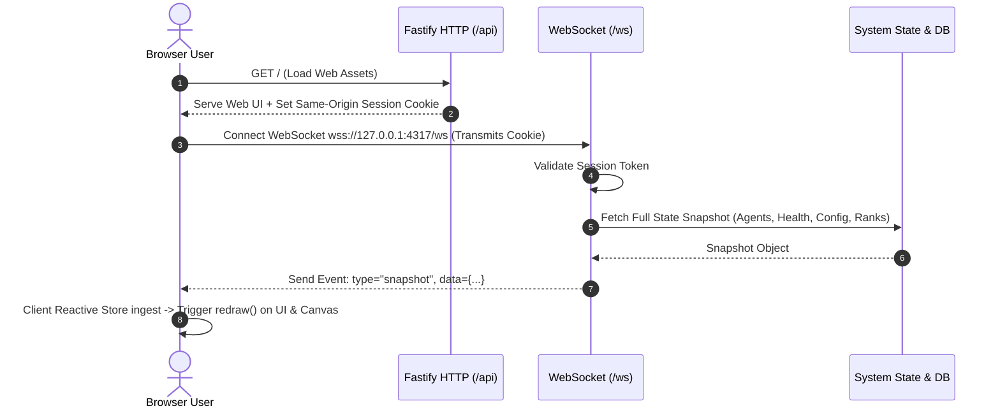
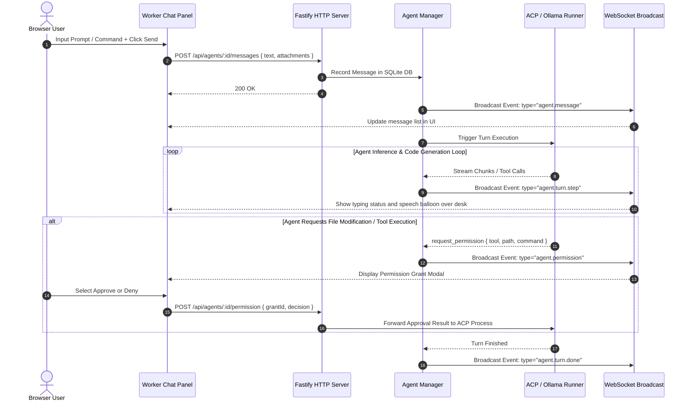
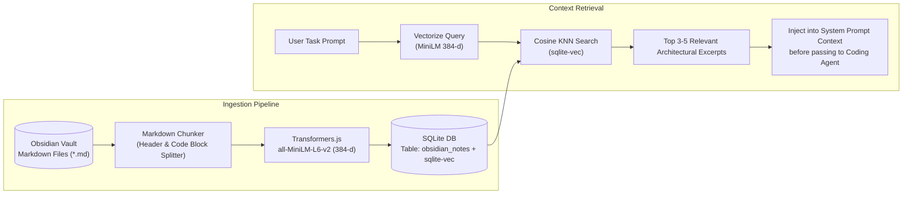

# End-to-End System Data Flow

This document outlines the four principal data flows in AgentCorp: Session Initialization & Snapshot, Agent Task Execution, Semantic Memory Retrieval, and Hybrid Local/Cloud AI Orchestration.

---

## 1. Session Initialization & State Snapshot Flow

---

## 2. Agent Chat & Task Execution Flow

---

## 3. Semantic Memory & Obsidian Vault Indexing Flow

---

## 4. Hybrid Local AI (Ollama) & Cloud ACP Agent Orchestration

1. **Preparation Phase (Local GPU / Ollama):**
   - User inputs a complex feature request or refactoring task.
   - **Local AI (Qwen3.5 on Ollama):** Scans the file tree, matches Obsidian architecture notes, and identifies target symbols using Graphify without spending cloud tokens.
2. **Execution Phase (Cloud ACP Agents - Claude Code / Codex):**
   - **Coding Agent:** Receives targeted file paths, AST contexts, and requirements instead of a full-repo prompt dump.
   - Modifies code within an isolated Git worktree (`data/git/worktrees/...`).
3. **Verification Phase:**
   - Runs automated test suite (`npm.cmd test`, `python -m graphify update .`).
   - Surfaces diff and status to user for final review.
