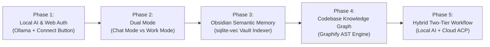

# Project Roadmap

Current milestone (2026-10-31): the Retro-only core and persistent assistant setup are implemented. New naming/removal checks and an explicit frontend build are available. Earlier milestones below are historical; unrelated provider, memory and review concerns still need separate verification.

## Audit priorities proposed on 2026-10-31 — not implemented

Các checkbox Completed/Verified phía dưới là lịch sử. Các hạng mục sau chưa được nghiệm thu lại trong lần tinh gọn này:

1. Chặn false approval, output review có schema/inconclusive, actual patch hoặc read-only tools; chạy lại fixture review lỗi/rỗng/EOF trước khi cho phép auto-review kết thúc workflow.
2. Scope đúng account/vault/repo cho memory và backup; respect enabled, transaction/staging, xóa index note bị xóa và retry partial embeddings; restore thử vào bản sao.
3. Bỏ universal RPC200{}, triển khai schema và lưu bền hoặc báo chưa hỗ trợ; sửa Messages/invite/feedback/GitHub broker mà không âm thầm nối lại publisher cloud.
4. Capability/validation/effective model và effort theo runner/model; session/error streaming; công bố giới hạn tools/attachments/MCP của local runner và sửa Office hidden-resize.
5. Sau correctness, đo scan/retrieval/quality/latency/VRAM và benchmark corpus; kiểm tra Host/Origin/WS/static debug files, env/ACL MCP và backend egress trong phạm vi được phép.

---

## 1. Development Phases

---

## 2. Phase Breakdown

### Phase 1: Local AI & Web Auth Connect (Completed)
- [x] Extracted and verified Windows local web port.
- [x] Standardized self-contained `/docs` hierarchy for zero-context onboarding.
- [x] Implemented `OllamaRunner` (`web/server/dist/agents/ollama-runner.js`) on port `11434`.
- [x] Implemented Web OAuth bridge with interactive **[Connect]** button for Claude, Codex, and Copilot.
- [x] Verified local Qwen3.5 hardware acceleration on RTX 3050 GPU.

### Phase 2: Dual Mode Architecture (Chat vs. Work) (Completed)
- [x] Implemented mode toggle `[ 🛠️ Work ]` / `[ 💬 Chat ]` in worker HUD (`worker.ts` and UI bundle).
- [x] **Chat Mode:**
  - Multi-turn conversational flow without mandatory Git repository binding or worktree creation.
  - Thinking Effort configuration (Instant, Low, Medium, High, Max).
- [x] **Work Mode:**
  - Full software engineering workflow: Git worktree isolation, supervised tool/permission grants, test verification.

### Phase 3: Obsidian Vault Semantic Memory (Completed)
- [x] Built `obsidian-indexer.js` for recursive Markdown chunking.
- [x] 384-d dense vector generation using local `Xenova/all-MiniLM-L6-v2` ONNX model.
- [x] Persisted vector records into SQLite using `sqlite-vec`.
- [x] REST endpoints `/api/obsidian/status` and `/api/obsidian/sync`.

### Phase 4: Codebase Knowledge Graph & Mandatory Skills (Completed)
- [x] Deployed 5 Mandatory Skills: `karpathy`, `ponytail`, `headroom`, `i-have-adhd`, `graphify`.
- [x] Integrated Graphify AST code engine: 2,883 nodes, 6,747 edges, 169 communities.
- [x] Provided single-command synchronization script [Sync-Graphify.ps1](file:///d:/Project/AgentCorp/scripts/Sync-Graphify.ps1).
- [x] Standardized all root and workspace instructions in professional English.

### Phase 5: Two-Tier Hybrid Workflow (Completed & Verified)
- [x] End-to-end multi-agent pipeline:
  1. **Tier 1 (Local AST Knowledge Graph - Graphify):** Reads user request, traverses AST graph, identifies impacted files, functions, and call graph in <20ms (`graph-navigator.js`).
  2. **Tier 2 (Cloud ACP - Claude Code / Codex / Copilot):** Receives pruned subgraph context and Obsidian ADRs to execute refactoring with minimal token burn.
- [x] **FEAT-006 Local AI Automated Code Review:** Ollama reviewer analyzes worktree diffs on RTX 3050 GPU and delivers structured `send_findings` (`approved` or `changes_requested`).
